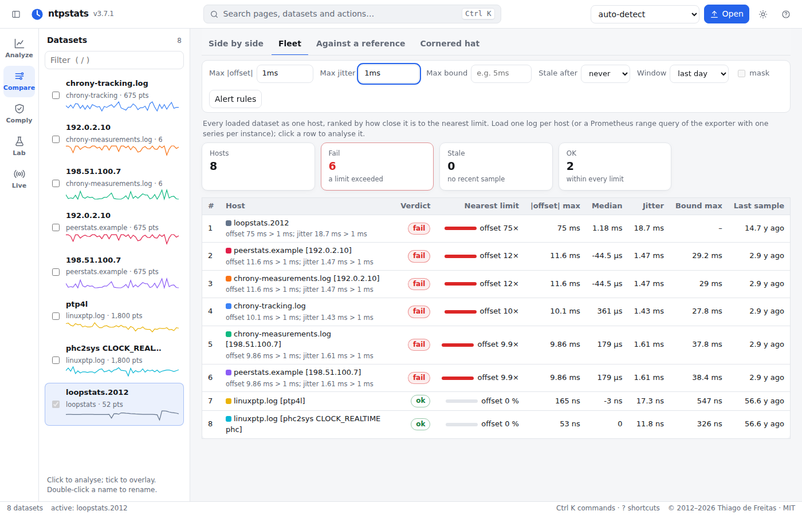

# Fleet view

One log tells how one host keeps time. An operator has hundreds, and the question is which of
them to look at first. `ntpstats fleet` checks every host against the same limits over its most
recent window and ranks them by how close each is to the nearest limit, so the host about to fail
comes first even when every host still passes.

```bash
ntpstats fleet /var/lib/timelogs --max-offset 1ms --max-jitter 100us --max-bound 5ms --max-age 10m
```

```text
4 hosts: 3 fail, 0 stale, 1 ok; limits offset 1 ms, jitter 100 µs, bound 5 ms, age 10 min; last 24 h of each log
  #  host                     verdict   usage  |offset| max    jitter  bound max       age  source
  1  cache1                   fail       308%        414 µs   60.6 µs    15.4 ms      60 s  offsets.csv
     - bound 15.4 ms > 5 ms
  2  db1                      fail       196%       1.06 ms    196 µs    2.06 ms      60 s  offsets.csv
     - offset 1.06 ms > 1 ms
     - jitter 196 µs > 100 µs
  3  web2                     fail       181%       1.81 ms   99.5 µs    5.81 ms      60 s  offsets.csv
     - offset 1.81 ms > 1 ms
     - bound 5.81 ms > 5 ms
  4  web1                     ok          20%        128 µs   20.5 µs     628 µs      60 s  offsets.csv
```

`cache1` has the smallest offset of the failing hosts, but its path delay is 30 ms: a clock can be
anywhere within half the round trip of its server, so its error bound is 15 ms. That is why the
bound is worth a limit of its own.

## Inputs

- **Files**: any log ntpstats reads (chrony, ntpd, ntpd-rs, linuxptp, captures, `watch` logs,
  instrument exports with `--columns`). Every file is one host.
- **Directories**: one sub-directory per host, as a log collector usually stores them; the host is
  the directory's name.
- **The exporter**: a Prometheus range query of `ntpstats monitor`/`watch --metrics-port`
  saved with `ntpstats prom`, read with `--all-peers`: each series is a host, named by its
  `instance` label.

```bash
ntpstats prom http://prometheus:9090 'ntpstats_offset_seconds' --since 24h -o fleet.json
ntpstats fleet fleet.json --all-peers --max-offset 1ms --max-age 5m
```

## Limits

| Option | Checked on the last `--window` (default 24 h) of each host |
|---|---|
| `--max-offset` | largest \|offset\| (default 1 ms; reference − local) |
| `--max-jitter` | standard deviation of the offset, as the exporter's `ntpstats_offset_stddev_seconds` |
| `--max-bound` | largest error bound \|offset\| + delay/2 + root delay/2 + root dispersion, with the terms the log has: the bound of [`ntpstats audit`](assurance.md) and of the exporter's `ntpstats_offset_bound_seconds` |
| `--max-age` | time since the last sample (relative to `--now`); such a host is *stale* |
| `--mask` | a TDEV or MTIE limit mask ([statistics](statistics.md#masks)) |

A host **fails** when a limit is exceeded, is **stale** when only its age is, and is **ok**
otherwise. *Usage* is value / limit for the nearest limit. `--strict` returns exit code 3 when
any host fails or is stale, so the command can gate a CI job or a cron alert; `--json` and
`--csv FILE` write the full table.

## Alert rules with the same limits

```bash
ntpstats fleet --rules fleet-rules.yml --max-offset 1ms --max-jitter 100us --max-bound 5ms --max-age 10m
```

writes Prometheus alerting rules for the exporter's metrics (`NtpstatsFleetOffset`,
`NtpstatsFleetJitter`, `NtpstatsFleetBound`, `NtpstatsFleetStale`) with exactly these
thresholds, so the alerts that page someone and the fleet report that explains them agree. Load
them next to the general rules in
[`contrib/prometheus/`](https://github.com/thiagodefreitas/NetworkTime/tree/master/contrib/prometheus)
([Monitoring](monitoring.md)).

## In the web UI

*Compare → Fleet* ranks every loaded dataset the same way, with the limits as fields, a usage
bar per host and an *Alert rules* button that downloads the rules for the limits on screen.
Clicking a host opens it in *Analyze*.



## In Python

```python
from ntpstats import load_one
from ntpstats.fleet import Thresholds, fleet, alert_rules

hosts = [load_one(p) for p in paths]
th = Thresholds(max_offset=1e-3, max_jitter=1e-4, max_bound=5e-3, max_age=600)
for row in fleet(hosts, th):
    print(row["rank"], row["host"], row["verdict"], row["usage"], row["reasons"])
open("rules.yml", "w").write(alert_rules(th))
```
